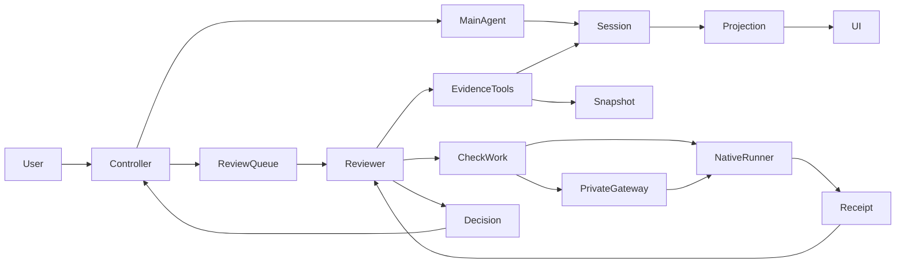

# Supervisor project architecture

## Summary

Supervisor is a native DSH plugin. A deterministic controller owns tasks, approval, dependency scheduling and final acceptance; the main Agent works and an independent reviewer provides evidence-backed judgments. Main Session events are authoritative; projections and caches are rebuildable. This page describes current source; see [review workflow](review-workflow.md) for validation of unpublished changes.

## Contents

- [Components and responsibilities](#components)
- [State and authorization](#state)
- [Evidence and review](#evidence)
- [Budgets and recovery](#recovery)
- [Integration and extensions](#integration)

## Components and responsibilities

Users express objectives through `/task`, the panel or conversation. Commands and panel actions reach the same controller; model tools propose plans, report artifacts and request acceptance.

| Module | Responsibility and boundary |
| --- | --- |
| `index.ts`, `decisions.ts`, `graph.ts` | Admission, approval, node attempts, continuation and terminal states; models do not grant execution permits. |
| `state.ts`, `session-records.ts` | Native control events, versioned replay and caches; no second source of user requirements. |
| `review-queue.ts`, `reviewer.ts` | Start review after main-turn settlement; bind identity, deadline and model; persist findings and decisions. |
| `review-results.ts`, `verification.ts` | Applicable requirements, original-read eligibility, independent inspection and comparison; reject unsupported passes. |
| `review-budget.ts`, `review-check-work.ts` | Separate model, check and wall budgets; persist check identity and receipts. |
| `check-gateway.ts`, `review-check.ts` | Administrator-selected isolated execution, resource ownership and cleanup; no Docker authority for the model. |
| `review-override.ts`, `client/` | Version-bound user release, human ending and actionable next steps; release is not acceptance. |

## State and authorization

A Task reaches `complete` through planning, plan review, approval, execution, node review and final acceptance. `paused` retains a decision or fault; `closed` means the user ended without final acceptance; `cleared` preserves history while removing the current task. See [task lifecycle](task-lifecycle.md) for transitions.

Dependency release and review success are separate: both `passed` and `user-released` unlock successors, but only the former counts as passed. Final acceptance checks all current requirements; node counts cannot substitute for it. User release binds one job, requirement version, plan version and node attempt; stale callbacks cannot override it.

Tasks retain native presets and disarm native Goal automatic continuation through the public GoalService. Goal and Plan history remains; native Plan approval does not approve a Task. Host permissions, read-only turns and container restrictions remain independent.

## Evidence and review

Each job binds the main Session, Task, requirement and plan versions, node attempt, reviewer Session, evidence cutoff and snapshot. Plan review checks feasibility and coverage; node review checks its node; final review checks the whole result. Final-only criteria do not become mandatory node criteria.

Log mode cites actually read originals. Independent mode inspects a snapshot, plans and runs necessary checks, saves findings, then compares main-Agent claims. Existing tests need inspection of assertions, execution paths, artifact identity and output; a passing test alone does not prove the requirement. Static requirements can use reads; behavior needs execution or reproduction; missing capabilities remain unverified.

Findings can be saved incrementally and referenced in the final decision. Same-job recovery reuses durable reads and findings; artifact changes invalidate old decisions. Prior conclusions from other jobs are location hints, not inherited acceptance. See [independent review](review-quality.md) and [review workflow](review-workflow.md).

## Budgets and recovery

Model time, check waiting and wall time each have a cap. During a check the model ends its turn; the controller waits for a receipt and continues. Only valid new findings permit model-budget extension. Earlier outer deadlines and user stops take precedence. [Review workflow](review-workflow.md) owns budget values, legacy configuration and unknown outcomes.

Stopping or disabling cancels plugin-owned model work, checks and continuation. Maintenance is released after check cleanup settles. Restart rebuilds durable state without automatically resuming the Task. Missing receipts never cause uncertain commands to be resubmitted or infrastructure faults to become product failures. Users see applicable retry, restart, release, pause or disable actions.

## Integration and extensions

The Host uses public Cordis effects, Sessions, Agents, Inbox, tools and projections; Web uses native conversation components, sidebar and locale. A missing plugin cannot enforce cold-start gates; hot unload and restart with the plugin are separate cases. See [implementation reference](implementation.md) and [native tasks](native-task.md).

D specialist review is an optional design, disabled by default; current code does not create multiple reviewers. A future interface binds scope, snapshot, capabilities, budget and result references; the main controller owns conflicts, cancellation and decisions. Specialists cannot expand objectives, mutate artifacts or bypass final acceptance.

## Dev Note

This page replaces the early architecture proposal and covers the whole project. Historical designs remain in proposals; release records identify shipped behavior. This change makes no claim of improved quality, latency or benchmark results.
