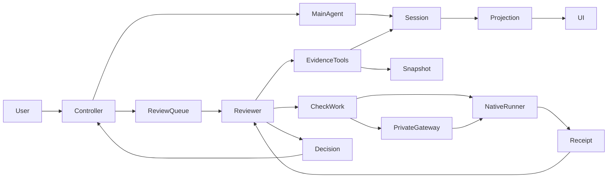

# Supervisor 项目架构

## 摘要

Supervisor 是 DSH 原生插件：确定性控制器维护任务、批准、依赖调度和最终验收，主 Agent 执行工作，独立审查者提供有证据的判断。主 Session 事件是事实来源，投影与缓存可重建。本文描述当前源码；未发布变更的验证状态见[审查工作流](review-workflow.zh.md)。

## 目录

- [组件与责任](#components)
- [状态与授权](#state)
- [证据与审查](#evidence)
- [预算与恢复](#recovery)
- [集成与扩展](#integration)

## 组件与责任

用户通过 `/task`、面板或对话表达目标。命令和面板进入同一控制器；模型工具提出计划、报告产物和申请验收。

| 模块 | 责任与边界 |
| --- | --- |
| `index.ts`、`decisions.ts`、`graph.ts` | 准入、批准、节点尝试、续行和终态；模型不直接授予执行许可。 |
| `state.ts`、`session-records.ts` | 原生控制事件、版本化回放与缓存；不创建第二份用户要求。 |
| `review-queue.ts`、`reviewer.ts` | 主轮次结清后启动审查，绑定身份、截止和模型，持久保存发现与裁决。 |
| `review-results.ts`、`verification.ts` | 适用要求、原文读取资格、独立取证与对照阶段；拒绝无证据的通过。 |
| `review-budget.ts`、`review-check-work.ts` | 分开模型、检查和总墙钟预算；保存检查身份及收据。 |
| `check-gateway.ts`、`review-check.ts` | 管理员指定的隔离执行、资源所有权与清理；不将 Docker 权限交给模型。 |
| `review-override.ts`、`client/` | 用户按当前版本放行、人工结束与可执行的下一步；放行不等于验收。 |

## 状态与授权

Task 经规划、计划审查、批准、执行、节点审查和整体验收进入 `complete`。`paused` 保存决策或故障；`closed` 表示用户结束且未通过最终验收；`cleared` 保留历史但清除当前任务。完整转换见[任务生命周期](task-lifecycle.zh.md)。

依赖释放与审查成功分别计算：`passed` 和 `user-released` 都可解锁后继节点，只有前者计入已通过数量。整体验收继续检查当前全部要求，不能把节点计数当作最终通过。用户放行限一个作业、要求版本、计划版本和节点尝试，旧回调不能覆盖它。

Task 保留原生 preset，通过公开 GoalService.disarm 解除原生 Goal 自动续行。Goal 与 Plan 的目标和历史保留；原生 Plan 批准不批准 Task。宿主权限、只读轮次和容器限制仍独立生效。

## 证据与审查

每个作业绑定主 Session、Task、要求与计划版本、节点尝试、审查 Session、证据截止和快照。计划审查判断可执行性和覆盖，节点审查判断当前节点，最终审查判断整体；每个节点无需回答最终专属标准。

日志模式引用实际读取的原文；独立模式先读取快照、设计并执行必要检查，再保存发现，最后对照主 Agent 汇报。已有测试需要审查断言、运行路径、产物身份及输出；测试通过本身不能证明需求正确。静态要求可通过阅读验证，行为要求需要执行或复现，缺少能力标记未验证。

发现可逐项保存，最终裁决引用已有结果。同作业恢复复用持久读取和发现，产物变更会使旧裁决失效。跨作业旧结论仅用于定位，不能自动继承验收资格。细节见[独立审查](review-quality.zh.md)和[审查工作流](review-workflow.zh.md)。

## 预算与恢复

模型计时、检查等待和总墙钟各有上限。检查运行时模型结束当前轮次，由控制器等待收据后继续；有效的新发现才能延长模型预算。任何外层更早的截止或用户停止优先。预算值、旧配置兼容和未知结果处理由[审查工作流](review-workflow.zh.md)统一定义。

停止或关闭取消插件拥有的模型、检查与续行。检查清理结清后才释放维护边界。重启恢复持久状态但不自动恢复任务；收据缺失时不重新投递不确定命令，不把基础设施故障当产品失败。用户看到重试、重新审查、放行、暂停或关闭等适用动作。

## 集成与扩展

Host 使用公开 Cordis effect、Session、Agent、Inbox、tools 和 projection；Web 使用原生对话组件、侧栏与 locale。插件冷缺失时不能声称仍有门禁；热卸载与装有插件的重启分别处理。配置与安装边界见[实现参考](implementation.zh.md)、[原生任务](native-task.zh.md)。

D 专项审查是可选扩展设计，默认关闭，当前不创建多审查者。将来以范围、快照、能力、预算和结果引用作为输入输出，主控制器统一合并冲突、取消和裁决。专项审查不能扩大用户目标、修改产物或绕过最终验收。

## Dev Note

此页替换早期架构提案，面向整个项目；历史方案保留在 proposals，已发布行为以发布记录为准。本轮不声称质量、时延或基准成绩改善。
